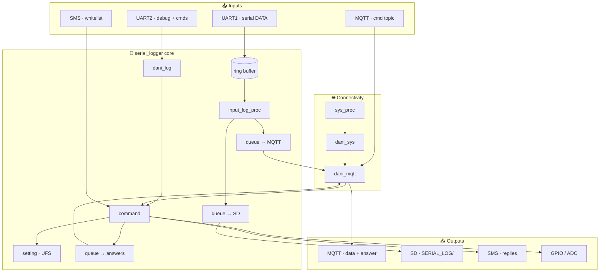

<div align="center">

# 📡 EC200 Serial Data Logger

**Cellular serial capture · MQTT cloud · SD storage · remote control**

*Quectel EC200U · OpenCPU / 8915DM Cat-1*

</div>

---

## 🎯 What this project is

This firmware turns a **Quectel EC200U** LTE module into a **remote serial logger** — the cellular equivalent of sitting on-site with a **USB‑to‑serial adapter**, but you can be anywhere with network access.

You wire the module’s **UART1** to the **TX/RX (and GND)** of the device you need to debug — a board, meter, PLC, gateway, etc. Everything that device prints on its debug/console UART is **captured**, **buffered**, and sent out in **near real time** over **MQTT** (internet). Optionally, the same stream is **appended to files on an SD card** on the module for local backup when cloud or coverage is unreliable.

So the EC200 board is not “the product under test”; it is the **logging bridge** between that product’s serial port and you, over the mobile network.

---

## 🧩 Problem it solves

| Situation | Without this | With this logger |
|:----------|:-------------|:-----------------|
| Field device misbehaves | Someone must travel with a laptop + USB‑serial cable | Serial output appears on MQTT (or on SD) while the unit stays installed |
| Cabinet is locked / site is remote | No physical access to the debug header | Logger stays wired; you read logs from afar |
| Intermittent faults | Hard to catch rare printouts | Continuous capture and upload (plus SD if enabled) |
| Changing APN / broker / phone number on site | Truck roll or local tool | Many settings via **SMS**, **MQTT commands**, or **UART2** |

**Typical use:** install the EC200 module next to the target, connect **UART1 ↔ target serial**, power both, ensure SIM and data work. Open an MQTT subscriber on the log topic (or pull files from SD later) and debug as if you were connected locally — without being there.

**Configuration from distance:** operators who only have a phone can whitelist their number and send text commands (`status`, `setpin`, broker settings, etc.) once `phonenumber` is provisioned; MQTT and the debug UART offer the same command set for richer workflows.

---

> **In one sentence**  
> A **remote USB‑to‑serial spirit** for embedded debug: **tap the target’s UART**, **stream logs over LTE/MQTT**, **optionally record on SD**, and **manage the box without visiting it**.

| | |
|:---|:---|
| 🧩 **Custom app** | `serial_logger/` → `ql_app_serial_logger` → firmware **`V01_APP`** |
| 💻 **PC serial over MQTT** | [`simple-virtual-serial-adaptor/`](simple-virtual-serial-adaptor/README.md) — minicom on your desk |
| 🏭 **Quectel SDK** | **Not in this repo** — download from Quectel, then run [`apply-to-sdk.sh`](apply-to-sdk.sh) |
| 📋 **Release gaps** | [VERSION_1_SHORTCOMINGS.md](VERSION_1_SHORTCOMINGS.md) |

---

## 🚀 Build this firmware (developer)

This repository is an **overlay** for the official Quectel OpenCPU SDK. You need the SDK on your machine first.

| Item | Value |
|------|--------|
| Module / project | **EC200UEU_AA** |
| SDK reference | **EC200UEUAAR03A14M08** (8915DM Cat-1 OpenCPU) |
| Build label | **V01** (third argument to `build_all.sh`) |

```bash
git clone https://github.com/danialkoosha56/Serial_BlackBox.git
cd Serial_BlackBox

# 1) Apply overlay onto your Quectel SDK tree
./apply-to-sdk.sh ~/path/to/quectel-opencpu-sdk

# 2) Build from the SDK root (not from this repo)
cd ~/path/to/quectel-opencpu-sdk
./build_all.sh new EC200UEU_AA V01
./build_all.sh r EC200UEU_AA V01          # incremental rebuild
```

Flash output: **`target/EC200UEU_AA_V01/`** (e.g. `8915DM_cat1_open_V01_merge.pac`, `V01_APP.pac`).  
Docker / QDloader notes: [`dani-addition.txt`](dani-addition.txt).

---

## 🗂️ What is in this repository

| 📁 Path | What it is |
|:--------|:-----------|
| **`sdk-overlay/serial_logger/`** | Application source (`ql_app_serial_logger`) |
| **`sdk-overlay/components/...`** | Small patches to Quectel demo/init (link app, SMS log hook, CMake) |
| **`patches/root-CMakeLists-add-serial_logger.patch`** | Registers `serial_logger/` at SDK root |
| **`apply-to-sdk.sh`** | Copies overlay + patch into your SDK tree |
| **`MANIFEST-sdk-overlay.txt`** | File list applied by the script |
| **`simple-virtual-serial-adaptor/`** | Linux PC tools: MQTT ↔ virtual serial |
| **`tools/build_and_program.sh`** | Optional build + flash helper (run from SDK root after overlay) |

The full Quectel **`components/`**, **`prebuilts/`**, and **`build_all.sh`** live only in the vendor SDK — not here.

---

## 💻 PC side: `simple-virtual-serial-adaptor/`

On the **module**, UART1 is the real wire to the device under test; logs leave over **LTE/MQTT**. On your **PC**, this folder is the other half of the “remote USB‑serial” idea: you do **not** need a cable from the EC200 to your laptop for debugging — you attach a **terminal program** to a **virtual serial port** that is fed by MQTT.

Full detail: **[simple-virtual-serial-adaptor/README.md](simple-virtual-serial-adaptor/README.md)**

### What it does

| Piece | Role |
|:------|:-----|
| **`mqtt_to_serial.py`** | Subscribes to **`my/test/uart/data`** → writes to a PTY; reads lines from the PTY → publishes to **`my/test/uart/cmd`** |
| **`mqtt_subscribe.py`** | Watch **`my/test/uart/answer`** (command replies — not merged into minicom today) |
| **`virtual_serial.py`** | Bench test: fake `Hello 0`, `Hello 1`, … into the bridge (simulates target UART) |
| **`read_serial.py`** | Simple line reader on the terminal side |
| **`vsa_paths.py`** | Portable paths (no fixed `/dev/ttyACM100` on every PC) |

### Desk operation (remote serial)


**Three terminals on Linux:**

```bash
cd simple-virtual-serial-adaptor

# 1) Virtual port pair (bridge ↔ terminal), user-writable paths
python3 -c "from vsa_paths import socat_pair_command; print(socat_pair_command())" | sh

# 2) MQTT bridge (defaults: test.mosquitto.org + EC200 topics)
python3 mqtt_to_serial.py

# 3) Your serial monitor
minicom -D "$(python3 -c 'from vsa_paths import terminal_path; print(terminal_path())')" -b 115200
```

- **Incoming logs** from the field module show up in minicom (MQTT → bridge → terminal).
- **Lines you type** in minicom are sent as MQTT commands to the module (same grammar as UART2 / SMS).

**Paths on any PC** (override with env):

| Variable | Typical default |
|:---------|:----------------|
| `VSA_STATE_DIR` | `~/.local/state/virtual-serial-adaptor` or under `$XDG_RUNTIME_DIR` |
| `VSA_BRIDGE` | `$VSA_STATE_DIR/bridge` — side **`mqtt_to_serial.py`** uses |
| `VSA_TERMINAL` | `$VSA_STATE_DIR/terminal` — side for **minicom** |

Requires **`mosquitto-clients`**; optional **`pyserial`** for `read_serial.py`.

### Bench operation (no cellular)

Use **`virtual_serial.py`** on the **bridge** path while **socat** is running, and wire a USB‑UART from that path into **EC200 UART1** — the module behaves as in the field, but the “device” is only a script on your desk.

---

## ⚙️ How it works

### Data & control flow



### 🚀 Boot sequence

*Source: `sdk-overlay/serial_logger/main/main.c`*

| Step | Module | What happens |
|:---:|:---|:---|
| 1 | `dani_log_init` | UART2 @ 115200 — framed logs + command RX |
| 2 | `setting_load` | Load `UFS:/setting.txt` (CRC) or factory defaults |
| 3 | `sd_proc_init` | SD task starts only if `sdcard enable` at boot |
| 4 | `dani_mqtt_app_init` | MQTT task + packet queues |
| 5 | `io_proc_init` | GPIO / ADC init |
| 6 | `sys_proc_init` | Network bootstrap, status, net LED |
| 7 | `dani_input_log_proc_app_init` | **UART1 logger** — ring buffer → MQTT / SD |
| 8 | `sms_proc_init` | SMS stack, whitelist, command dispatch |

---

## 🔗 Modules & connections

| Module | RTOS task | Pulls from | Feeds |
|:-------|:----------|:-----------|:------|
| **dani_log** | *(ISR/callback)* | UART2 | Debug TX · commands into `command` |
| **command** | — | setting, mqtt, sms, io, sys | Parse CLI · `cmd_ans` → MQTT / SMS |
| **setting** | — | UFS flash | Persistent config struct |
| **input_log_proc** | `IN_LOG_PROC` | UART1, ring_buffer | `mqtt_uart_post` · `sd_log_post` |
| **mqtt_proc** | `dani_mqtt` | dani_sys, queues | Publish logs · subscribe cmds |
| **sd_proc** | `sd_proc` | RTC, queues, setting | Append under `SD:/SERIAL_LOG/` |
| **sms_proc** | `sms_proc` | setting | Whitelist · `cmd_procc(SMS)` · replies |
| **sys_proc** | `sys_proc` | dani_sys, GPIO LED | Registration, PDP, periodic status |
| **dani_sys** | — | SIM / NW / datacall | `sys_info` for `status` & MQTT wait |
| **io_proc** | `io_proc` | GPIO, ADC | `setpin` · `readinput` · `readadc` |
| **pkt_queue** | — | RTOS | Safe handoff between tasks |
| **ring_buffer** | — | — | UART1 RX staging |

### 🔌 UART roles

| Port | Baud *(today)* | Role |
|:-----|:---------------|:-----|
| **UART1** | `115200` fixed | 📊 **Data** — device under test / meter / PLC |
| **UART2** | `115200` fixed | 🛠️ **Ops** — live logs + text commands |

### ☁️ MQTT *(hardcoded in `mqtt_proc.c`)*

| Topic | ↕ | Use |
|:------|:-:|:----|
| `my/test/uart/data` | ↑ publish | Serial log payloads |
| `my/test/uart/cmd` | ↓ subscribe | Remote commands |
| `my/test/uart/answer` | ↑ publish | Command responses |

**Broker (code today):** `mqtt://test.mosquitto.org:1883`  
*Settings file stores broker fields — runtime wiring is still TODO.*

### 💾 Persistence

| Store | Location | Format |
|:------|:---------|:-------|
| **Settings** | `UFS:/setting.txt` | Binary struct + CRC32 |
| **SD logs** | `SD:/SERIAL_LOG/` | `YYYY-MM-DD___HH-MM.txt` |

---

### ✅ Ready today

| Feature | Notes |
|:--------|:------|
| UART1 capture + ring buffer | 75% high-water wake · 10 s timer flush |
| MQTT log upload | Queued publish · auto reconnect |
| UART2 framed debug logs | Window IDs via `dani_log` |
| MQTT remote commands | Cmd topic in · answer topic out |
| Settings save / load | UFS + CRC survives reboot |
| `help` · `status` · `reboot` · `echo` | Core CLI |
| Cellular network + PDP | `dani_sys` + `sys_proc` |
| SD file rotation by RTC | Uses `capturetime` (≥ 60 s) |
| `setpin` · `readinput` · `readadc` | Fixed GPIO10 / GPIO11 / ADC0 |
| IO status logging | Every 5 s |
| SMS whitelist + replies | After `phonenumber` is configured |

### 🟡 Partial / caveats

| Feature | Notes |
|:--------|:------|
| SD logging | Needs `sdcard enable` **before boot** + successful mount |
| UART2 commands | Parsed · **no reply written to UART2** |
| SMS commands | Default empty `phone_number` → all SMS ignored |
| `phonenumber` | Works · omitted from `help` |
| SMS test on boot | Only when number is already set |
| Forward to SD | Same as SD row above |
| Pin mux for IO | GPIO init only — board-dependent |

### ⬜ Planned / stored but not active

| Feature | Notes |
|:--------|:------|
| `uartbaud` | Saved · UART stays 115200 |
| `capturesize` | Saved · flush size ~2048 fixed |
| `capturetime` on UART flush | Timer 10 s fixed · SD uses setting |
| `mqtt enable/disable` | Saved · MQTT always runs |
| Broker URL / port / user / pass | Saved · hardcoded connect |
| `brokertopic` → live topics | Three topics fixed in code |
| `sdcard enable` after boot | No task restart |
| `output1` → hardware | Help vs handler mismatch · no GPIO apply |
| `cmd2device` gate | Saved · not enforced |
| Binary-safe `%s` logging | Risk on raw serial bytes |
| Overflow visibility | Ring buffer / queues can drop silently |
| Strict command token parse | `strstr` substring match today |
| FOTA | — |
| TLS / MQTT auth | — |
| Timestamps on MQTT payloads | `log_pkt_t` fields unused |

---

## 🎮 Command reference

*Case-insensitive · sources: **UART2** · **MQTT cmd** · **SMS** (whitelisted)*

| Command | Purpose |
|:--------|:--------|
| `help` | Show examples |
| `status` | SIM · CSQ · IP · uptime · MQTT stats |
| `reboot` | Module reset |
| `echo <text>` | Echo (MQTT / SMS) |
| `sdcard enable/disable` | Persist SD flag |
| `mqtt enable/disable` | Persist MQTT flag *(runtime N/A)* |
| `brokerurl` … `brokertopic` | Persist broker config |
| `uartbaud` · `capturesize` · `capturetime` | Persist logger params |
| `output1 enable/disable` | Persist output flag *(not on pin)* |
| `setpin high/low` | Drive output GPIO |
| `readinput` · `readadc` | Read input / ADC |
| `cmd2device enable/disable` | Persist remote-cmd flag *(not enforced)* |
| `phonenumber <n>` | SMS allow-list + test SMS target |

---

## 🎯 Vision vs v1 today

| | |
|:--|:--|
| **🎯 Goal** | Field **serial logger** on LTE: stream in · store local/cloud · configure remotely |
| **📦 v1 today** | UART1 → MQTT path works with default Mosquitto topics; SD & SMS need provisioning; many CLI keys are **saved for later** but don’t change behavior yet |
| **📋 Next** | Close gaps in [VERSION_1_SHORTCOMINGS.md](VERSION_1_SHORTCOMINGS.md) before calling it a full **v1.0** release |

---

## Privacy & license

`sdk-overlay/components/ql-application/sms/sms_demo.c` may contain a hard-coded test phone number from development — change it before production use.

Application code in **`sdk-overlay/serial_logger/`** is yours to license. Quectel SDK files remain subject to Quectel’s terms when you apply the overlay.

---

<div align="center">

*Serial BlackBox · firmware overlay for Quectel EC200U OpenCPU*

</div>
